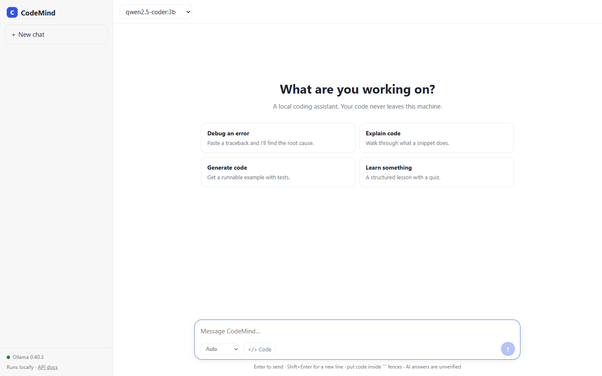
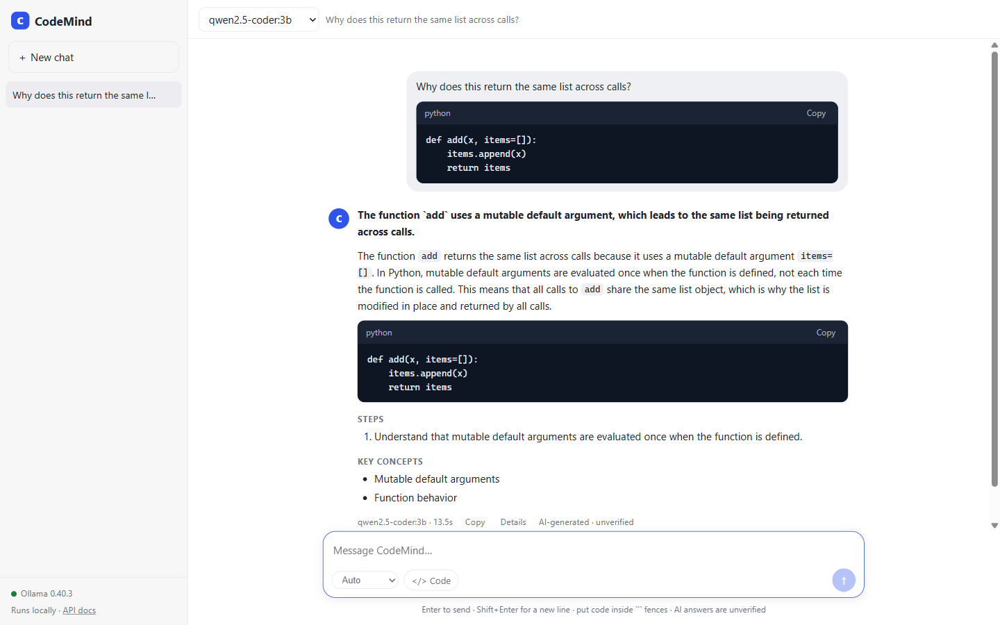
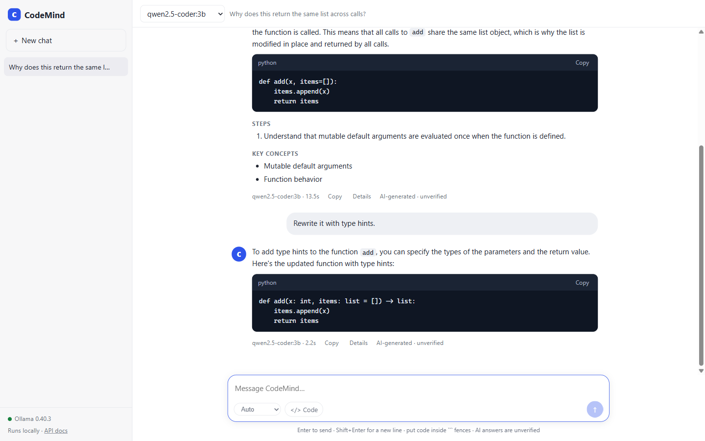
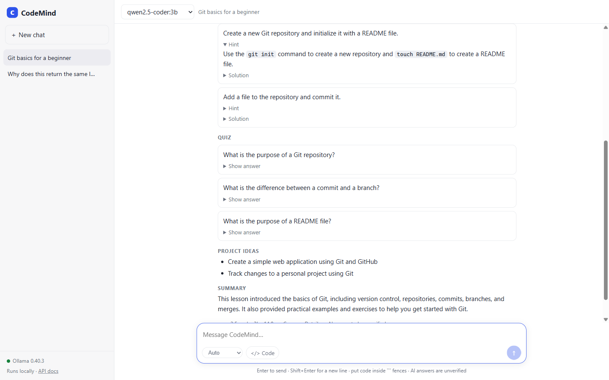
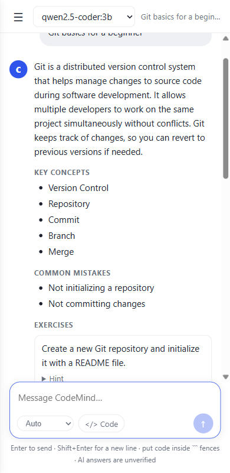
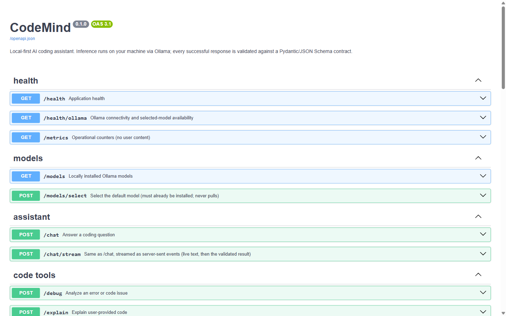

# CodeMind

**A private, local AI coding assistant with a ChatGPT-style interface.** It runs open-source models
on your own computer through [Ollama](https://ollama.com). No cloud AI, no API keys, no
subscription, and your code never leaves your machine.



- **Chat UI** with conversation history, live streaming text, code blocks with copy buttons, and
  one-click follow-up questions.
- **Six modes:** Ask, Debug, Explain, Generate, Review, Learn (lessons, exercises, quizzes).
- **Reliable output:** every answer is validated against a Pydantic/JSON Schema contract. If the
  model returns something malformed, CodeMind retries and repairs it automatically.
- **Fast:** about 2 to 6 seconds for typical answers on a modest laptop GPU (see
  [Performance](#performance-and-choosing-a-model)).
- Also a **CLI** and a documented **REST API** (Swagger UI).

> **Honest expectations:** CodeMind guarantees the *shape* of an answer, not its *correctness*.
> Small local models make mistakes (see the screenshots below). Always read and test generated code.

---

## Contents

1. [Quick start](#quick-start-windows)
2. [Using the chat UI](#using-the-chat-ui)
3. [Daily use: start, stop, update](#daily-use)
4. [Command line](#command-line)
5. [REST API](#rest-api)
6. [Performance and choosing a model](#performance-and-choosing-a-model)
7. [Configuration](#configuration)
8. [How it works](#how-it-works)
9. [Project layout](#project-layout)
10. [Tests, lint, evaluation](#tests-lint-evaluation)
11. [Privacy](#privacy-and-local-data)
12. [Troubleshooting](#troubleshooting)
13. [Known limitations](#known-limitations)

---

## Quick start (Windows)

You need about **5 GB of free disk**, Python 3.12+ and Ollama. Total time: roughly 10 minutes,
mostly downloads.

### 1. Install Python 3.12 or newer

Check what you have:

```powershell
python --version
```

If it is older than 3.12 or missing, install it from <https://www.python.org/downloads/>
(tick **"Add python.exe to PATH"** in the installer).

### 2. Install Ollama

```powershell
winget install Ollama.Ollama
```

Or download the installer from <https://ollama.com/download>. After installing, Ollama runs in the
background (system tray). Verify:

```powershell
ollama --version
```

> If `ollama` is "not recognized", open a **new** terminal window. If it still is not found, run it
> by full path: `& "$env:LOCALAPPDATA\Programs\Ollama\ollama.exe" --version`.

### 3. Download a model (one time, about 2 GB)

```powershell
ollama pull qwen2.5-coder:3b
```

CodeMind never downloads models by itself; you always do it explicitly like this.

### 4. Get the project and install dependencies

Open PowerShell in the project folder (the one containing `pyproject.toml`):

```powershell
cd path\to\CodeMind
python -m venv .venv
.\.venv\Scripts\Activate.ps1
pip install -e ".[dev]"
Copy-Item .env.example .env
```

> If PowerShell refuses to run `Activate.ps1`, run
> `Set-ExecutionPolicy -Scope CurrentUser RemoteSigned` once, or skip activation and call
> `.\.venv\Scripts\python.exe` directly in the commands below.

### 5. Start CodeMind

```powershell
python -m app.cli serve
```

You should see `Uvicorn running on http://127.0.0.1:8000`. **Leave this window open.**

### 6. Open the app

Go to **<http://127.0.0.1:8000>** in your browser. The sidebar shows a green dot and
"Ollama 0.x" when everything is connected. Type a question and press Enter.

That's it.

<details>
<summary><b>macOS / Linux</b></summary>

```bash
# 1. Python 3.12+:    python3 --version
# 2. Ollama:          https://ollama.com/download   (macOS app, or: curl -fsSL https://ollama.com/install.sh | sh)
ollama pull qwen2.5-coder:3b

cd path/to/CodeMind
python3 -m venv .venv
source .venv/bin/activate
pip install -e ".[dev]"
cp .env.example .env

python -m app.cli serve        # then open http://127.0.0.1:8000
```
</details>

### Check that everything is wired up

With the server running, in a second terminal:

```powershell
python -m app.cli health
```

Expected:

```
Ollama 0.40.3 reachable at http://127.0.0.1:11434
structured output: yes
model qwen2.5-coder:3b: installed
```

---

## Using the chat UI

### A conversation

Ask anything. CodeMind keeps the conversation, so follow-ups like "rewrite it with type hints" know
what "it" is. Code you put in a fenced block (three backticks) is sent as code context and shown in
a code card.



Each answer shows the model used and the time taken, a **Copy** button, a **Details** toggle
(the raw validated JSON, plus how many attempts it took) and a reminder that the answer is
AI-generated and unverified.

### Follow-ups and history

Conversations are listed in the left sidebar and are saved in **your browser only**
(`localStorage`); nothing is stored on the server. Warm follow-ups are usually 2 to 4 seconds.



### Learn mode: lessons, exercises and quizzes

Switch the mode picker (next to the `</> Code` button) to **Learn** and type a topic. You get an
explanation, key concepts, common mistakes, exercises with hints and solutions, a quiz with
click-to-reveal answers, project ideas and a summary. Lessons are longer, so they take
about 15 seconds.



### Modes

| Mode | Use it for | Tip |
| ---- | ---------- | --- |
| **Auto** | Let CodeMind decide (default) | It picks Debug when it sees a traceback, Review when you say "review", and so on |
| **Ask** | Programming questions | |
| **Debug** | Errors and stack traces | Paste the traceback and the code in fenced blocks |
| **Explain** | "What does this code do?" | Paste code, optionally say "line by line" |
| **Generate** | Write new code | Mention the language and framework |
| **Review** | Code review | Covers correctness, readability, performance, security |
| **Learn** | Structured lessons | Just type the topic |

### Keyboard and controls

| Action | How |
| ------ | --- |
| Send | `Enter` |
| New line | `Shift+Enter` |
| Insert a code block | the `</> Code` button |
| Stop a running answer | the square button (replaces the send arrow while generating) |
| Switch model | dropdown at the top (remembered in your browser) |
| New / delete chat | `+ New chat` / the `x` that appears when hovering a chat |
| Follow-up | click a suggested question under an answer |

### On a phone or narrow window

The sidebar collapses behind the menu button. If you run CodeMind on one computer, you can open it
from your phone on the same Wi-Fi by starting it with `python -m app.cli serve --host 0.0.0.0`
(only on a network you trust, because the API has no login).



---

## Daily use

| I want to... | Do this |
| ------------ | ------- |
| Start | `cd` into the project, activate the venv, `python -m app.cli serve`, open <http://127.0.0.1:8000> |
| Stop | Press `Ctrl+C` in the server window |
| Use a different port | `python -m app.cli serve --port 9000` |
| Switch model for good | Set `OLLAMA_MODEL=...` in `.env`, restart |
| Switch model once | Use the dropdown in the UI, or `--model` on the CLI |
| See installed models | `python -m app.cli models` (or `ollama list`) |
| Install another model | `ollama pull <name>` (then pick it in the UI) |
| Remove a model to free disk | `ollama rm <name>` |
| Update the project | Replace the files, run `pip install -e ".[dev]"` again, restart |

The first request after a long idle period can take a few extra seconds while Ollama loads the model
into memory. CodeMind loads it for you at startup and asks Ollama to keep it for 30 minutes.

---

## Command line

Everything the UI does is available in the terminal. (Add `--json` to any command for the full
validated JSON.)

```powershell
python -m app.cli ask "How do I read a file line by line in Python?"
python -m app.cli ask "Why is this slow?" --code script.py
python -m app.cli debug --error trace.txt --code app.py
python -m app.cli explain --code app.py --line-by-line
python -m app.cli generate "a FastAPI endpoint returning server time" --language python --tests
python -m app.cli review --code app.py
python -m app.cli learn "Docker" --difficulty beginner --aspects concepts exercises quiz
python -m app.cli models
python -m app.cli models --pull qwen2.5-coder:1.5b     # explicit download
python -m app.cli health
python -m app.cli serve --port 8000
```

`--code -` and `--error -` read from standard input, for example
`Get-Content app.py | python -m app.cli review --code -`.
After `pip install -e .` you can also type `codemind ...` instead of `python -m app.cli ...`.

---

## REST API

Interactive documentation (try every endpoint in the browser): **<http://127.0.0.1:8000/docs>**



| Endpoint | Purpose |
| -------- | ------- |
| `GET /health` | Application health |
| `GET /health/ollama` | Ollama connectivity, version, selected-model status |
| `GET /models` | Installed models and the selected one |
| `POST /models/select` | Select an installed model (in memory; never downloads) |
| `POST /chat` | Answer a question; accepts `history` and an optional `mode` |
| `POST /chat/stream` | Same, as server-sent events (live text, then the validated result) |
| `POST /debug` | Analyze an error or code issue |
| `POST /explain` | Explain code |
| `POST /generate` | Generate code |
| `POST /review` | Review code |
| `POST /learn` | Structured lesson / exercises / quiz (`/learn/stream` also exists) |
| `GET /metrics` | Counters only (no user content) |

PowerShell:

```powershell
Invoke-RestMethod http://127.0.0.1:8000/chat -Method Post -ContentType application/json `
  -Body '{"question": "How do I square every number in a list?", "language": "python"}'
```

curl:

```bash
curl -s http://127.0.0.1:8000/chat -H "content-type: application/json" \
  -d '{"question": "How do I square every number in a list?", "language": "python"}'
```

Response (trimmed):

```json
{
  "request_id": "3f9c1d0a52be",
  "mode": "ask",
  "model": "qwen2.5-coder:3b",
  "response": {
    "status": "success",
    "intent": "coding_question",
    "answer": "Use a list comprehension to build a new list of squares.",
    "code_blocks": [{"language": "python", "code": "squares = [x * x for x in numbers]"}],
    "steps": [], "concepts": ["list comprehension"], "assumptions": [],
    "follow_up_questions": [], "sources": [], "error": null
  },
  "schema_valid": true,
  "ai_generated": true,
  "verified": false,
  "retry": {"attempts": 1, "max_attempts": 3, "transport_retries": 0, "outcome": "success"},
  "elapsed_ms": 4210
}
```

Errors always use the same shape, `{"error": {"code", "message"}, "request_id", "retry"}`, with a
useful HTTP status: `422` invalid request, `404` model not installed, `502` model failed or retries
exhausted, `503` Ollama not reachable, `504` timeout. Stack traces, file paths and raw model output
are never returned.

---

## Performance and choosing a model

### What decides speed

Local speed depends mostly on whether the **whole model fits in your GPU's memory (VRAM)**. When it
does, it runs at ~40 tokens/second here. When it spills over into CPU/RAM it is several times
slower. Test machine: 31 GB RAM, **4 GB VRAM** (RTX 500 Ada laptop GPU).

### Benchmark (12 representative coding tasks)

| Model | Size | Fully on this GPU? | Seconds per answer | Schema valid | First-try valid | Content checks passed* |
| ----- | ---- | ------------------ | ------------------ | ------------ | --------------- | ---------------------- |
| `qwen2.5-coder:1.5b` | 1.0 GB | yes | 9.7 | 100% | 92% | 67% |
| **`qwen2.5-coder:3b`** (default) | 1.9 GB | **yes** | **5.7** | 100% | 100% | 75% |
| `llama3.2:3b` | 2.0 GB | yes | 8.6 | 100% | 100% | 75% |
| `qwen2.5-coder:7b` | 4.7 GB | no (split with CPU) | 28.1 | 100% | 100% | 92% |

\* Content checks are keyword/shape heuristics (e.g. "mentions `GROUP BY`", "has a code block").
They are **not** a measure of correctness. Timings are whole-answer wall-clock times on this one
machine. The 1.5b run shared the GPU with other work and needed a retry on one case, so treat its
timing as noisy; it should not really be slower than the 3b. Your numbers will differ.

### Recommendation

- **Best for a 4 GB GPU / the 5 to 6 second target: `qwen2.5-coder:3b`.** It is the default. Typical
  answers take 2 to 6 seconds, with the first words appearing in under 2 seconds.
- **Best quality: `qwen2.5-coder:7b`** (noticeably better content, but about 5x slower on 4 GB VRAM).
  On a GPU with 8 GB or more it should be fast too.
- Bigger machines: `qwen2.5-coder:14b` (needs roughly 12 GB VRAM for good speed).
- Very small machines (no GPU, 8 GB RAM): `qwen2.5-coder:1.5b`.

| Your hardware | Suggested model |
| ------------- | --------------- |
| No GPU, 8 GB RAM | `qwen2.5-coder:1.5b` |
| 4 GB VRAM or 16 GB RAM | `qwen2.5-coder:3b` |
| 8 GB VRAM | `qwen2.5-coder:7b` |
| 12+ GB VRAM | `qwen2.5-coder:14b` |

### Why it feels fast

1. **Streaming:** the answer text appears as it is generated (first words in ~1 to 2 s), while the
   complete result is still fully validated at the end.
2. **Warm start:** the model is loaded when the server starts and kept in memory for 30 minutes.
3. **Concise by default:** the system prompt asks for short answers with the minimum working code,
   and the output cap is 1024 tokens.

Cold start (the first request after Ollama unloaded the model, for example after you ran a different
model) costs an extra ~5 to 10 seconds once.

### Run the benchmark yourself

```powershell
python scripts\run_eval.py --models qwen2.5-coder:3b qwen2.5-coder:7b
```

Cases live in `tests/eval/cases.json`; add your own.

---

## Configuration

All settings are optional environment variables (or lines in `.env`); see `.env.example`.
Invalid values stop the app at startup with a clear message.

| Variable | Default | Meaning |
| -------- | ------- | ------- |
| `OLLAMA_BASE_URL` | `http://localhost:11434` | Where Ollama listens (use `127.0.0.1` on Windows for faster connects) |
| `OLLAMA_MODEL` | `qwen2.5-coder:3b` | Default model; must already be installed |
| `OLLAMA_TIMEOUT_SECONDS` | `120` | Per-call timeout |
| `OLLAMA_NUM_CTX` | `8192` | Context window (more = more RAM) |
| `OLLAMA_KEEP_ALIVE` | `30m` | How long the model stays in memory |
| `WARMUP_ON_START` | `true` | Load the model at startup (never downloads) |
| `MAX_GENERATION_RETRIES` | `2` | Retries for invalid model output |
| `MAX_TRANSPORT_RETRIES` | `2` | Retries for transient connection/timeout/5xx errors |
| `MAX_RETRY_BACKOFF_SECONDS` | `8` | Cap for retry backoff |
| `REQUEST_DEADLINE_SECONDS` | `300` | Hard limit for one request including retries |
| `DEFAULT_TEMPERATURE` | `0.2` | Lower = more deterministic |
| `MAX_OUTPUT_TOKENS` | `1024` | Output cap (truncated JSON is invalid, so do not set too low) |
| `STRICT_SCHEMA` | `true` | Reject unexpected fields (`false` drops them instead) |
| `LOG_LEVEL` | `INFO` | `DEBUG`, `INFO`, `WARNING`, `ERROR` |

---

## How it works

```
Browser UI / CLI / API client
        |
        v
   FastAPI routes ----- validate request (Pydantic, unknown fields rejected)
        |
        v
   assistant_service -- model choice, deadline, logging, result envelope
        |
        v
   StructuredGenerator (retry_service)
     1. prompt_builder    system prompt + JSON Schema + mode template + chat history
     2. ollama_client     /api/chat with the schema as constrained output, streamed
     3. response_validator extract JSON -> Pydantic validate
     4. on failure        regenerate with feedback, or send a separate repair prompt
        |
        v
   validated AssistantResult  (or a structured error, never malformed JSON)
```

**Structured output.** `AssistantResponse` in `app/schemas/responses.py` is the single source of
truth. Its JSON Schema comes straight from `AssistantResponse.model_json_schema()`, is passed to
Ollama as the `format` (constrained decoding), and the reply is validated again with Pydantic. Only a
validated object is returned. Model-invented `sources` are always discarded; only sources you supply
are returned.

**Retries.** Two independent policies:

| Policy | Triggers | Behaviour |
| ------ | -------- | --------- |
| Generation | invalid JSON, empty reply, schema violation | up to `MAX_GENERATION_RETRIES`; not-JSON gets *regenerated* with concise feedback, valid-JSON-wrong-shape gets a separate *repair* prompt |
| Transport | connection failure, timeout, HTTP 429/5xx | up to `MAX_TRANSPORT_RETRIES`, exponential backoff with jitter |

Missing models, bad requests and other 4xx errors are never retried. Retries stop at the request
deadline, and feedback sent to the model contains field paths and messages only, never your values.

**Streaming.** `/chat/stream` sends `delta` events (the answer text so far), then one `result`
event with the fully validated response, or an `error` event. Closing the connection cancels the
generation.

**Conversation memory.** The browser sends the last turns with each request; the server stores
nothing. Prior assistant turns are replayed as JSON so the model keeps the output format.

---

## Project layout

```
app/
  main.py                 app factory, error handlers, serves the UI at /
  cli.py                  `codemind` command
  evaluation.py           evaluation harness
  static/index.html       the chat UI (single file, no build step)
  api/
    routes/               health, models, chat, code_tools, learning
    streaming.py          server-sent events bridge
  core/                   config, exceptions, structured logging + metrics
  schemas/                requests.py, responses.py, errors.py
  services/               ollama_client, prompt_builder, response_validator,
                          retry_service, assistant_service, learning_service
  prompts/*.txt           system, chat, debug, explain, learn, generate, review, retry, repair
  utils/                  json_parser, timing
tests/unit  tests/integration  tests/eval
scripts/run_eval.py       benchmark models
docs/images/              README screenshots
```

---

## Tests, lint, evaluation

```powershell
python -m pytest                    # 111 unit tests; Ollama is mocked, no model needed
python -m pytest -m integration     # optional: uses your real Ollama + model (skips if absent)
ruff check .                        # lint
ruff format --check .               # formatting
python scripts\run_eval.py          # evaluation against your local model
```

The unit tests cover valid/invalid JSON, missing fields, bad enums and types, extra fields,
recovery after one or several bad responses, retry exhaustion, Ollama unavailable, model not
installed, timeouts, transient HTTP errors, request validation, API contract consistency, prompt
construction, every mode, streaming, and conversation history.

---

## Privacy and local data

- All inference goes to `OLLAMA_BASE_URL` (your own machine by default). There are no other outbound
  calls: no analytics, no cloud AI.
- Logs are structured JSON with request ID, model, mode, latency, attempts and failure category.
  **Prompts, code and raw model output are not logged.**
- `/metrics` exposes counters only. The server persists nothing; chat history lives in your
  browser's `localStorage` (clear it with the `x` buttons or your browser's site-data controls).
- The API has **no authentication**. Keep the default `127.0.0.1` binding unless you are on a
  trusted network.
- `.env` is git-ignored. Do not commit real secrets (CodeMind needs none).

---

## Troubleshooting

| Symptom | Fix |
| ------- | --- |
| Red dot / "Ollama is not reachable" | Start Ollama (tray app, or `ollama serve`) and refresh; check `OLLAMA_BASE_URL` |
| `model_not_found` | `ollama pull qwen2.5-coder:3b`, or pick an installed model in the dropdown / `.env` |
| Answers are slow (30 s+) | The model does not fit your GPU. Use a smaller model (`qwen2.5-coder:3b`); check with `ollama ps` that the PROCESSOR column says `100% GPU` |
| First answer is slow, later ones are fast | Normal: the model was loading. `WARMUP_ON_START=true` (default) avoids it after a restart |
| Slow to connect on Windows | Set `OLLAMA_BASE_URL=http://127.0.0.1:11434` |
| `generation_failed` | The model kept returning invalid output. Try a larger model, lower `DEFAULT_TEMPERATURE`, or raise `MAX_OUTPUT_TOKENS` |
| Answer cut off / invalid JSON on long outputs | Raise `MAX_OUTPUT_TOKENS` (default 1024) |
| Long code is ignored | Raise `OLLAMA_NUM_CTX` (needs more memory) |
| Page looks old after an update | Hard refresh (`Ctrl+F5`) |
| `Activate.ps1 cannot be loaded` | `Set-ExecutionPolicy -Scope CurrentUser RemoteSigned` |
| Port 8000 already in use | `python -m app.cli serve --port 8001` |
| `ollama` not recognized | Open a new terminal, or use `& "$env:LOCALAPPDATA\Programs\Ollama\ollama.exe"` |

---

## Known limitations

- Local small models can be wrong, can repeat mistakes (the screenshot above shows a 3b model
  reproducing a bug it was asked about), and can miss details. Verify everything.
- Only Ollama is supported as a backend; there is no web search, so `sources` only contains what you
  supply.
- Learn mode produces long structured output and takes about 15 seconds on the default model.
- Stopping an answer in the UI stops the stream; the model may take a moment to finish its current
  token batch.
- `POST /models/select` is in memory and resets on restart (use `OLLAMA_MODEL` in `.env` to persist).
- Chat history is per browser; it is not synced between devices.
